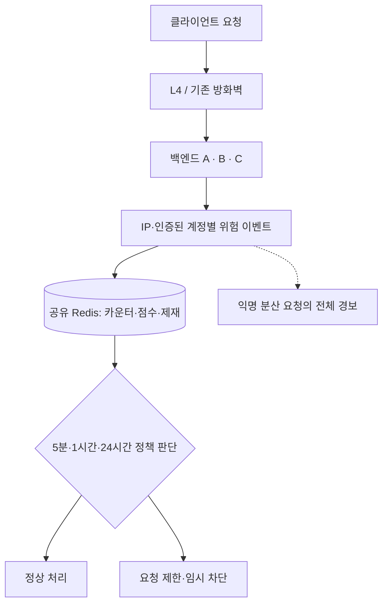

# Node API Abuse Guard

**Node.js · Express · Redis 기반의 행동 기반 API 남용 탐지 및 자동 제한 예제**

*An educational Redis-backed API abuse detection and mitigation example.*

> [!IMPORTANT]
> 이 저장소는 **백엔드 개발자가 구현할 수 있는 2차 방어 설계 예제**입니다. 운영용 WAF, DDoS 방어 장비, 인증·인가 시스템을 대체하지 않습니다. 실제 적용 전에 트래픽·오탐·장애 대응을 검증해야 합니다.

## 프로젝트 소개

단순 IP 블랙리스트는 짧은 시간의 반복 호출을 막는 데 유용하지만, IP가 바뀌거나 요청 간격이 길어지는 상황에서는 한계가 있습니다.

이 프로젝트는 아래 관점에서 출발했습니다.

- IP와 **인증된 계정**을 별도 기준으로 집계합니다.
- 5분·1시간·24시간이라는 **여러 시간 창**을 함께 관찰합니다.
- **카운터(Counter)**와 **위험 점수(Score)** 모드를 구분합니다.
- L4 아래 여러 백엔드 서버가 **Redis를 통해 동일한 상태**를 확인합니다.
- **임시 차단의 만료 시간**과 **관리자 수동 차단**을 분리합니다.
- 인증 없는 IP 로테이션 요청은 동일 공격자라고 확정하지 않고 **전체 이상 경향만 관찰**합니다.

기본 구현은 미등록 API 경로(`404`)의 반복 요청만 실제로 기록합니다. 인증 실패·권한 위반·비정상 업무 순서 위반은 서비스마다 의미가 다르므로, 각 업무 핸들러에 명시적으로 연결해야 합니다.

## 동작 구조



이 폴더는 Backend Engineering Notes의 첫 번째 주제입니다. 실행 코드와 테스트는 [behavioral_guard_example](behavioral_guard_example/)에 있습니다.

## 주요 기능

| 기능 | 구현 방식 |
| --- | --- |
| 위험 이벤트 수집 | 미등록 `/api` 경로, 명시적으로 기록한 권한·업무 위반 |
| 카운터/점수 모드 | `DETECTION_MODE=counter` 또는 `score` |
| 복수 시간 창 | 5분 / 1시간 / 24시간 고정 시간 창 |
| 다중 백엔드 공유 | 같은 Redis 마스터·DB·접두사·모드·HMAC 비밀값·정책 사용 |
| 동시성 제어 | 독점 연결의 `WATCH` → Node.js 판정 → `MULTI/EXEC`, 충돌 시 최대 32회 시도 |
| 자동 IP 제한 | 기본 30분 TTL |
| 계정 임시 차단 | 기본 15분 동안 모든 `/api` 요청 거절(인증 연동 필요) |
| 수동 차단 | TTL 없는 별도 관리자용 Redis 키 조회 |
| 익명 분산 요청 | 5분간 미등록 API 요청의 전체 증가량을 경보로 표시 |
| 키 데이터 최소화 | IP/계정 문자열을 HMAC-SHA256으로 변환 |

### 카운터와 점수의 차이

| 모드 | 미등록 경로 | 인증 실패 | 인가 거절 | 비정상 업무 상태 |
| --- | ---: | ---: | ---: | ---: |
| Counter | 1회 | 1회 | 1회 | 1회 |
| Score | +1점 | +2점 | +3점 | +8점 |

초깃값은 **시연용 예시**이며, 서버 트래픽과 정상 사용 패턴에 맞게 보정해야 합니다.

| 관찰 구간 | Counter 한도 | Score 한도 |
| --- | ---: | ---: |
| 5분 | 8회 | 12점 |
| 1시간 | 24회 | 36점 |
| 24시간 | 60회 | 90점 |

> **알고리즘 주의:** 이 코드는 고정 시간 버킷(Fixed Window)을 사용합니다. 버킷 경계에서 요청이 분산될 수 있으므로, 시간 구간별 집계 정밀도가 필요하면 Sliding Window를 검토하세요. Token Bucket은 정상 요청을 포함한 처리량 제어의 별도 선택지입니다.

## 시작하기

### 요구 사항

- Node.js **22 이상** (검증 환경: 24.22.1)
- Redis **7 이상** (`EXPIRE NX` 사용, 검증 환경: Redis 7.4 컨테이너)
- npm (Express 5.3.0 / node-redis 6.3.1을 lockfile로 고정)

### 1. 설치

저장소 루트에서 **샘플 폴더로 이동한 뒤** 설치하세요.

```bash
cd behavioral_guard/behavioral_guard_example
npm ci
```

로컬 Redis가 없다면 Docker로 실행할 수 있습니다.

```bash
docker run --detach --rm --name behavioral-guard-redis --publish 127.0.0.1:16379:6379 redis:7.4-alpine
```

### 2. 환경 설정

같은 터미널 세션에서 설정합니다. 비밀값은 화면이나 파일에 출력하지 않고 환경 변수에 넣습니다.

Linux/macOS:

```bash
export REDIS_URL="redis://127.0.0.1:16379"
export DEFENSE_HMAC_SECRET="$(node -e "process.stdout.write(require('node:crypto').randomBytes(32).toString('hex'))")"
export DETECTION_MODE="score"
```

Windows PowerShell:

```powershell
$env:REDIS_URL = "redis://127.0.0.1:16379"
$env:DEFENSE_HMAC_SECRET = node -e "process.stdout.write(require('node:crypto').randomBytes(32).toString('hex'))"
$env:DETECTION_MODE = "score"
```

`DETECTION_MODE`는 `score` 또는 `counter`입니다. HMAC 비밀값은 32자 이상의 무작위 값이 필요하며 모든 백엔드에서 동일해야 합니다. 실행할 때마다 바꾸면 기존 키와 연결되지 않습니다.

프록시 환경에서는 `TRUST_PROXY_CIDRS`에 실제 신뢰할 프록시 CIDR만 쉼표로 구분해 지정하세요. 기본은 프록시 비신뢰이며, `trust proxy=true`를 무조건 적용하지 않습니다.

### 3. 서버 실행

```bash
npm start
```

시연 서버는 `127.0.0.1:3000`에 바인딩합니다. `PORT`로 포트를 바꿀 수 있습니다. 환경 변수 미설정 시 Redis 기본 주소는 `redis://127.0.0.1:6379`이며, `.env` 파일은 자동으로 읽지 않습니다.

### 4. 동작 확인

정상 API:

```bash
curl -i http://127.0.0.1:3000/api/ping
```

미등록 API:

```bash
curl -i http://127.0.0.1:3000/api/missing-route
```

새 IP 버킷 기준으로 score 모드는 12번째 미등록 경로 호출까지 `404`를 반환하면서 제재를 만들고, 그 다음 `/api` 요청부터 `429`를 반환합니다(counter 모드는 8번째). `/health`는 계속 `200`인 생존 확인용 경로이며 Redis 준비 상태를 보장하지 않습니다. TTL이 끝나면 정상 요청이 다시 허용되지만, 관찰 점수가 남아 있으면 다음 위험 이벤트에서 재차 제재될 수 있습니다.

**주의:** 같은 컴퓨터에서 테스트하는 다른 요청도 IP 기준 제한에 영향을 받습니다. Redis에 남아 있는 테스트 키를 확인하거나 만료 시점까지 기다린 뒤 재시험하세요.

### 5. 테스트

샘플 폴더에서 실행합니다.

```bash
npm test
npm run test:integration
```

- `npm test`: Redis 없이 실행하는 9개 단위 테스트.
- `npm run test:integration`: 전용 Redis를 사용하는 13개 통합 테스트. 기본 주소는 `redis://127.0.0.1:16379`, 다른 주소는 `REDIS_TEST_URL`로 지정합니다.
- 통합 테스트는 무작위 키 접두사와 임시 Redis ACL 사용자를 생성한 뒤 해당 자원만 정리합니다. **ACL 관리 권한이 있는 전용 테스트 Redis**를 사용하세요.
- 검증 범위: 두 연결 풀의 동시 누적, IP 변경 계정, 단기·장기 창, TTL·수동 차단, 실제 HTTP, 스크립트 실행 권한이 없는 계정에서의 집계·제재.
- 1시간·24시간 창은 주입한 시간으로 버킷을 이동해 검증했습니다. 제재 만료 복구는 테스트에서 TTL을 짧게 설정하여 확인합니다.

## 기존 서비스에 연동하기

[behavioral_guard.js](behavioral_guard_example/behavioral_guard.js)의 `createGuard(redisPool, options)`가 탐지 미들웨어와 위험 이벤트 기록 함수를 제공합니다. 다음 예제의 상대 경로는 샘플 폴더 기준입니다.

```javascript
const { createGuard, createRedisPool } = require("./behavioral_guard");

async function attachGuard(app, verifiedAuthenticationMiddleware) {
    const redis = createRedisPool(process.env.REDIS_URL);
    redis.on("error", () => console.error("Redis connection error"));
    const { abuseGate, safeObserve } = createGuard(redis, {
        hmacSecret: process.env.DEFENSE_HMAC_SECRET,
        mode: "score"
    });
    await redis.connect();
    app.use("/api", verifiedAuthenticationMiddleware);
    app.use("/api", abuseGate);

    // 업무 코드에서 await safeObserve(req, "AUTHORIZATION_DENIED") 등을 호출합니다.
    // 앱 종료 시에는 await redis.close()로 풀을 닫습니다.
    return { redis, safeObserve };
}
```

이 예제의 `createApp()`에는 **실제 로그인·인가 구현이 포함되어 있지 않습니다.** `req.user.id`는 검증된 인증 미들웨어에서 생성될 때에만 계정 기준 집계에 사용됩니다. `X-User-Id` 등 클라이언트 제공 값을 그대로 넣어서는 안 됩니다.

또한 위험 점수는 **인증·인가·주문 상태 검증을 대신하지 않습니다.** 잘못된 비즈니스 상태 전이는 점수와 관계없이 반드시 서버에서 거절해야 합니다.

## 저장과 동시성

판정 로직은 JavaScript에서 실행합니다. Redis에는 스크립트를 전송하지 않습니다.

1. 풀에서 연결을 독점하고 주체별 고정 버킷을 `WATCH`합니다.
2. 기존 값을 읽고 Node.js에서 다음 점수와 임계치 도달 여부를 계산합니다.
3. 증분·최초 TTL·필요한 임시 차단을 하나의 `MULTI/EXEC`에 넣습니다.
4. 다른 서버의 변경으로 충돌하면 다시 읽어 계산합니다. 최대 32회 후에는 오류로 처리하고, `safeObserve`는 기록 실패를 알린 뒤 요청을 계속 처리합니다.
5. 완료·오류 뒤에는 `UNWATCH`로 연결 상태를 정리합니다. 연결이 바뀌면 이전 조회 결과로 새 `EXEC`를 보내지 않습니다.

전역 경보 카운터는 `INCR`와 `EXPIRE NX`를 한 트랜잭션으로 저장합니다. 시각은 Redis `TIME`을 기준으로 하며, 키의 TTL은 최초 저장 때만 설정합니다.

원자성 범위는 **주체 하나의 저장 작업**입니다. IP·계정·전역 집계 전체가 하나의 트랜잭션은 아니며, Redis 실행 중 명령 오류에는 롤백이 없습니다. `EXEC` 응답이 유실되면 적용 여부가 불명확하므로 연결 오류를 자동 재시도하지 않습니다. 정확히 한 번 기록을 보장하는 이벤트 저장소가 아닙니다.

현재 연결 구현은 **단일 Redis 마스터용**입니다. 키에 hash tag는 사용하지만 Redis Cluster 클라이언트·장애 조치까지 구현하거나 검증한 것은 아닙니다. 읽기 복제본에서 제재를 조회하면 복제 지연 문제가 생길 수 있습니다.

### 키 형식

```text
abuse:example:v1:risk:{ip:<HMAC>}:score:5m:<bucket>
abuse:example:v1:risk:{account:<HMAC>}:score:24h:<bucket>
abuse:example:v1:deny:auto:{ip:<HMAC>}       # 30분
abuse:example:v1:deny:auto:{account:<HMAC>}  # 15분
abuse:example:v1:deny:manual:{ip:<HMAC>}     # 운영자가 설정한 수동 차단
abuse:example:v1:observe:unknown-route:5m:<bucket>
```

HMAC 입력은 `ip:<원문 IP>` 또는 `account:<검증된 ID>`입니다. HMAC은 익명성 보장이 아니라 키에 원문을 직접 노출하지 않는 수단이며, 비밀값의 접근·교체를 관리해야 합니다. 수동 키를 생성하거나 해제하는 관리자 API는 제공하지 않습니다.

## 저장소 구성

```text
BackendEngineeringNotes/
├── README.md
├── .gitignore
├── .gitattributes
└── behavioral_guard/
    ├── README.md
    └── behavioral_guard_example/
        ├── behavioral_guard.js
        ├── package.json
        ├── package-lock.json
        └── test/
            ├── guard.test.js
            └── guard.integration.js
```

## 운영 전 확인해야 할 사항

1. 실제 클라이언트 IP가 신뢰된 프록시 경로를 거쳐 전달되는지 확인합니다.
2. Redis 장애가 발생하면 본 샘플은 **포착된 오류에 한해 fail-open**으로 동작합니다. 풀 획득 대기는 300ms로 제한하지만, 전체 명령 대기시간 상한·회로 차단·시작 시 재연결 한도는 별도 구현이 필요합니다. 장애나 충돌 포화 시 집계가 빠질 수 있습니다.
3. NAT·회사망·모바일 네트워크에서 IP 공동 사용에 따른 오탐을 검증합니다.
4. Redis 메모리 사용량, TTL, HMAC 비밀값 교체를 관리합니다.
5. 자동으로 영구 차단하지 않습니다. 수동 제재에는 승인·감사·해제 절차가 필요합니다.
6. 성능 제한, 인증 남용, 데이터 추출 등 **정상 응답을 반환하는 API 남용**은 본 기본 404 이벤트만으로 탐지하지 못합니다.
7. 익명 IP 로테이션 트래픽은 동일 행위자로 확정할 수 없으므로 전역 경향만으로 전체 사용자를 차단하지 않습니다.
8. 현재 계정 조치는 속도 조절이나 추가 인증이 아닌 모든 `/api`의 임시 차단입니다. 운영에서는 민감 경로별 제한·추가 인증 등 단계적 정책을 별도로 연동하세요.
9. 정상 요청도 먼저 제재 조회를 수행하므로 백엔드·Redis 부하를 측정하세요. 이 예제에는 일반 처리량 제한, 대기열 전체 상한, 메모리 대체 방어, 관리자 UI가 포함되지 않습니다.

## 참고 자료

- [OWASP — Bot Management and Anti-Automation](https://cheatsheetseries.owasp.org/cheatsheets/Bot_Management_and_Anti-Automation_Cheat_Sheet.html)
- [OWASP — REST Assessment](https://cheatsheetseries.owasp.org/cheatsheets/REST_Assessment_Cheat_Sheet.html)
- [Express — Behind Proxies](https://expressjs.com/en/guide/behind-proxies/)
- [Redis — Node.js Client](https://redis.io/docs/latest/develop/clients/nodejs/)
- [Redis — Transactions](https://redis.io/docs/latest/develop/using-commands/transactions/)
- [Redis — node-redis Pipelines and Transactions](https://redis.io/docs/latest/develop/clients/nodejs/transpipe/)
- [Redis — Rate Limiting Algorithms](https://redis.io/docs/latest/develop/use-cases/rate-limiter/nodejs/)

## 라이선스

라이선스는 아직 선택하지 않았으며 `LICENSE` 파일은 포함하지 않습니다.

---

**GitHub 저장소 설명(About) 제안:** `A Redis-backed, multi-window API abuse detection example for Node.js and Express.`

**Topics 제안:** `nodejs`, `express`, `redis`, `api-security`, `rate-limiting`, `behavioral-detection`, `application-security`, `commonjs`
