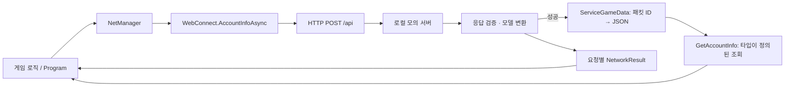

# Client Network SDK

**서버 개발팀이 Unity 클라이언트의 통신 계층을 제공했던 경험과, 그 구조를 줄인 C# 예제**

클라이언트팀에 게임 기능과 UI 작업이 집중되어 있던 프로젝트에서 서버팀이 요청 연결·응답 파싱·데이터 보관을 공통 모듈로 제공했습니다. 클라이언트는 API 함수와 타입이 정의된 응답 모델을 이용해 게임 로직을 구현하도록 했습니다.

당시 프로젝트는 개발·테스트 이후 정식 오픈으로 이어지지 않았습니다. 이 문서는 **실제로 확인한 소스 구조와 설계 의도**를 정리하며, 운영 안정성이나 개발 기간 단축을 측정한 사례는 아닙니다.

## 예제의 범위

원본 `Web.zip`을 검토하고 **계정 정보 조회 한 가지**로 다시 작성했습니다. Unity와 기존 게임 프로젝트 없이 `.NET 10` 콘솔 앱으로 실행합니다.

- `NetManager → WebConnect → HTTP → 응답 모델 → ServiceGameData` 흐름을 유지합니다.
- 내부에는 `Dictionary<int, string>`으로 JSON을 저장하고, 외부에는 `ResponseAccountInfo`를 제공합니다.
- 로컬 모의 서버를 자동으로 시작해 **실제 HTTP 요청과 JSON 직렬화·역직렬화**를 실행합니다.
- 요청마다 `Task`로 결과를 돌려주며, 오류 표시는 호출하는 게임/UI 코드가 결정합니다.

원본의 TCP·Protobuf, 로그인, 암호화, 재시도 UI, 게임 데이터 전체는 포함하지 않습니다. 원본 서버와 호환되는 SDK나 Unity에 그대로 붙여 넣는 패키지가 아니라 **책임 분리를 읽고 실행해 보는 예제**입니다.

## 원본에서 확인한 구성

아래 경로는 제공받은 압축 파일 내부 기준입니다. 원본 소스·DLL·Unity Scene은 이 저장소에 복사하지 않았습니다.

| 원본 파일 | 확인한 역할 | 간단한 예제에서의 처리 |
| --- | --- | --- |
| `Web/NetManager.cs` | `WebConnect`, `SocketConnect` 생성과 접근 | `NetManager.cs`: HTTP 진입점만 제공 |
| `Web/WebConnect.cs` | 공통 요청 큐, 코루틴 통신, 패킷 생성, 데이터 조회 | `WebConnect.cs`: `HttpClient`와 요청별 비동기 결과 |
| `Web/ApiServices/ApiAccountInfo.cs` | `WebConnect`의 partial 구현, 계정 요청 및 응답 저장 | `AccountInfoAsync()` 하나로 축소 |
| `Web/GameCallBackList.cs` | API별 콜백 필드 | 공유 콜백 없이 호출한 `Task`에 결과 반환 |
| `Web/ServiceGameData.cs` | 패킷 ID별 JSON 저장, 조회 때 응답 모델로 변환 | 같은 저장 원리를 작은 클래스로 유지 |
| `Web/Packet/Request`, `Response` | 요청·응답 모델 | 닉네임·레벨·골드만 남긴 `Models.cs` |
| `Web/SocketConnect.cs` | TCP 길이 헤더, Protobuf 직렬화와 수신 큐 | 설명에만 포함 |

`ApiServices`는 독립된 서비스 객체 모음이 아니라 **`WebConnect` partial 클래스를 API별 파일로 나눈 구성**입니다. 원본 계정 정보의 setter는 JSON을 `GenDataHash(packetId, json)`에 전달하며, 이 함수가 Dictionary를 갱신합니다. getter는 해당 JSON을 다시 역직렬화합니다.

## 동작 흐름



핵심은 **통신 구현과 내부 저장 방식을 게임 로직에서 숨기는 것**입니다. 계정 정보 조회에서 캐시를 먼저 확인해 통신을 생략하지는 않습니다. 요청은 항상 서버로 보내고, 성공한 결과를 보관합니다.

## 설치와 실행

요구 사항은 **.NET 10 SDK**입니다. 추가 NuGet 패키지, Unity, DB는 필요하지 않습니다. 서버 실행에는 SDK에 포함된 ASP.NET Core 공유 프레임워크를 사용합니다.

저장소 루트에서:

```powershell
cd client_network_sdk/client_network_sdk_example
dotnet run
```

프로그램은 `127.0.0.1`의 임시 포트에 모의 서버를 띄우고, 한 번 조회한 뒤 서버와 함께 종료합니다. 외부 게임 서버에 접속하지 않습니다.

예상 출력:

```text
조회 전 캐시: 없음
응답: DemoPlayer, Lv.12, Gold=3500
캐시: DemoPlayer, Lv.12, Gold=3500
```

검증 실행:

```powershell
dotnet run -- --verify
```

검증에는 실제 로컬 HTTP 호출, 요청 형식, 최초 캐시 부재, 인스턴스별 저장 분리, HTTP/API 오류, 오류 응답의 다양한 `data` 형식, 잘못된 JSON·필수 값·값 범위, 지원하지 않는 `charset`, UTF-16 한글 응답, 취소, 타임아웃, 동시 요청의 결과 분리를 포함합니다. 실패 시 예외와 0이 아닌 종료 코드로 끝납니다. 오류·동시성 시나리오는 `HttpMessageHandler`를 대체해 재현합니다.

Windows / .NET SDK 10.0.103에서 빌드 경고·오류 0개, 데모 실행, **30개 검증 항목 통과**를 확인했습니다.

## 클라이언트에서 사용하는 모습

아래 코드는 이미 구성한 `HttpClient`를 전달받았다고 가정합니다. 실행 가능한 전체 호출부는 `Program.cs`에 있습니다.

```csharp
var web = new NetManager(httpClient).GetWebConnect();
var result = await web.AccountInfoAsync(cancellationToken);

if (result.IsSuccess && result.Data is { } account)
{
    Console.WriteLine($"Lv.{account.Level}, Gold={account.Gold}");
}
else
{
    Console.WriteLine($"조회 실패: {result.Error}");
}

// 이전 성공 응답의 스냅샷. 최초 성공 전에는 null입니다.
ResponseAccountInfo? cached = web.GetAccountInfo;
```

각 요청의 화면 갱신에는 **`result.Data`**를 사용합니다. `GetAccountInfo`는 공유 저장소의 마지막 성공 스냅샷이므로 동시 요청 시 특정 요청의 결과와 같다고 보장할 수 없습니다.

## 예제용 통신 규약

`POST /api` 요청:

```json
{"packetId":1001,"data":{}}
```

성공 응답:

```json
{"packetId":1001,"code":0,"data":{"nickname":"DemoPlayer","level":12,"gold":3500}}
```

업무 오류 응답 예시:

```json
{"packetId":1001,"code":1401,"data":{"message":"Login required"}}
```

`1001`은 예제용 ID이고 `code: 0`은 성공입니다. 유효한 JSON과 공통 필드 `packetId`, `code`를 먼저 검사합니다. 패킷 ID가 일치하고 `code`가 0이 아니면 `Api`와 해당 오류 코드를 반환하며, `data`를 계정 모델로 변환하지 않습니다. 오류 응답의 `data`는 객체·문자열·null이거나 생략되어도 됩니다.

계정 모델 변환은 `code: 0`일 때만 수행합니다. 원본의 문자열 `data` 봉투를 성공 응답의 중첩 JSON 객체로 단순화했으며, 원본의 인증 필드와 전송 형식을 재현하지 않았습니다.

| 결과 | 처리 |
| --- | --- |
| 정상 응답 | 모델 검증 후 저장하고 이 요청의 모델 반환 |
| HTTP 오류 | `Http`와 HTTP 상태 코드 반환 |
| 업무 오류 | `Api`와 서버의 오류 코드 반환 |
| 잘못된 JSON·필수 필드 누락·잘못된 값·지원하지 않는 charset | `InvalidResponse` 반환 |
| 연결 실패 | `Connection` 반환 |
| 호출자 취소 / 제한 시간 초과 | `Cancelled` / `Timeout` 반환 |

모든 응답에서 `packetId`, `code`를 필수로 검사하고, 성공 응답에서는 계정의 세 필드도 필수로 검사합니다. 레벨은 1 이상, 골드는 0 이상, 닉네임은 공백이 아닌 문자열이어야 합니다. `required`로 필드 누락을 검사하고 별도 조건문으로 값의 유효성을 확인합니다. [System.Text.Json 필수 속성](https://learn.microsoft.com/en-us/dotnet/standard/serialization/system-text-json/required-properties)

실패한 요청은 캐시를 변경하지 않습니다. 이전 성공 데이터가 남더라도 **이번 요청이 성공했다는 의미는 아닙니다.** 오류 본문이나 원본 요청 전체를 로그로 출력하지 않습니다.

## 원본과 구분할 점

원본은 공통 요청 큐로 통신을 순서대로 처리하지만, 계정 콜백은 `accountInfoResponseCB`라는 공유 필드에 넣습니다. 앞선 요청이 끝나기 전에 같은 API를 다시 호출하면 필드가 교체될 여지가 있습니다. 예제는 요청별 반환값으로 이 결합을 없앴습니다. 이는 소스에서 확인한 가능성이며 당시 장애 발생을 확인한 것은 아닙니다.

원본의 `WWWError()`는 UI 다이얼로그와 로그인 화면 전환에 연결되어 있습니다. 예제는 오류 결과만 제공해 통신 계층이 화면을 결정하지 않게 했습니다.

원본 `SocketConnect`는 4바이트 헤더와 본문을 각각 한 번의 `Read`로 읽고 다음 처리를 진행합니다. TCP를 다시 구현한다면 정확한 길이까지 읽는 반복 처리, 길이 상한, 연결 종료 처리가 필요합니다. `Read`의 반환 길이는 요청한 길이보다 작을 수 있습니다. [NetworkStream.Read](https://learn.microsoft.com/en-us/dotnet/api/system.net.sockets.networkstream.read?view=net-10.0)

## 단순화를 위해 남긴 한계

- **캐시 최신성:** Dictionary 접근은 잠금으로 보호하지만 저장 순서는 응답 완료 순서입니다. 먼저 시작한 요청이 늦게 끝나면 더 오래된 서버 상태를 덮어쓸 수 있습니다. 서버 버전 비교·요청 직렬화 정책은 구현하지 않았습니다.
- **캐시 수명:** TTL·영속 저장·오프라인 동작은 없습니다. 한 `NetManager`는 한 사용자 세션 범위로 가정하며, 세션 종료 시 진행 중 요청을 취소하고 해당 인스턴스를 폐기해야 합니다.
- **조회 비용:** 원본 설명을 위해 JSON Dictionary 방식을 유지했습니다. 조회마다 역직렬화하므로 자주 읽는 데이터에는 타입이 정의된 객체 캐시를 검토할 수 있습니다.
- **실제 서비스 연동:** 인증·인가, HTTPS 서버, 재시도와 멱등성, SDK 버전 호환성은 별도 설계가 필요합니다. 데모의 HTTP는 loopback에만 사용합니다.
- **Unity 이식:** `MonoBehaviour`, 코루틴, 메인 스레드 UI 갱신, IL2CPP/AOT는 검증하지 않았습니다. 이 콘솔 프로젝트를 Unity 프로젝트에 그대로 넣는 용도가 아닙니다.

`HttpClient`는 호출자가 재사용하고 종료 시 해제합니다. 예제 호출부는 5초 타임아웃과 64 KiB 응답 버퍼 한도를 지정합니다. 실제 서비스에서는 연결 수명과 DNS 변경도 고려해야 합니다. [HttpClient 사용 지침](https://learn.microsoft.com/en-us/dotnet/fundamentals/networking/http/httpclient-guidelines)

## 파일 구성과 읽는 순서

```text
client_network_sdk/
├── README.md
├── client_network_sdk_case_study.md  # 로컬용 회고·블로그 초안
├── Linkedin.md                       # 로컬용 게시글 초안
└── client_network_sdk_example/
    ├── ClientNetworkSdkExample.csproj
    ├── Program.cs                    # 1. 클라이언트의 호출 방법
    ├── NetManager.cs                 # 2. 공통 진입점
    ├── WebConnect.cs                 # 3. 계정 조회와 오류 처리
    ├── Models.cs                     # 4. 요청·응답 계약
    ├── ServiceGameData.cs            # 5. 패킷 ID별 JSON 저장
    ├── DemoServer.cs                 # 실행용 로컬 모의 서버
    └── Verification.cs               # 동작 검증
```

원본은 구조를 확인하는 참고 자료로 사용했고, 예제 구현은 위 범위에 맞춰 새로 작성했습니다. 기존 문서와 동일하게 채널별 초안과 빌드 산출물은 Git 추적에서 제외합니다.
