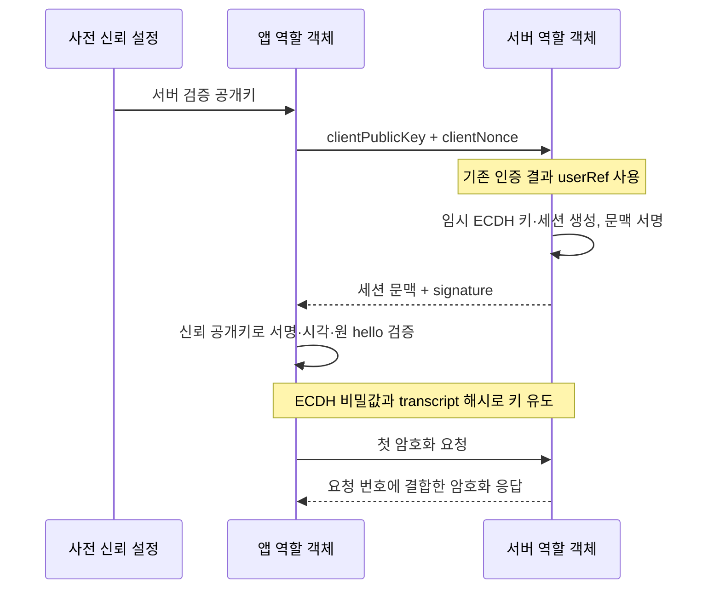

# 모바일 API 데이터 암호화 상세 설계

이 문서는 [기술 글](mobile_api_encryption_article.md)의 구현 계약을 구체화한다. 아래에서 **구현**은 로컬 예제의 동작, **운영 확장**은 아직 구현·검증하지 않은 사항을 뜻한다. 프로토콜 보안 검토나 모바일 상호 운용성 검증이 완료된 명세가 아니다.

**GitHub 코드와 실행 안내:** [모바일 API 데이터 암호화](https://github.com/devmakermin/BackendEngineeringNotes/tree/main/mobile_api_encryption)

## 1. 목표와 신뢰 경계

목표는 TLS 종료 중간 시스템이 본문 원문을 볼 필요가 없는 구조를 설명하는 것이다. 앱과 지정 API 복호화 서버는 평문에 접근하며, HTTPS와 기존 인증·인가는 계속 필요하다.

| 대상 | 신뢰와 보호 가정 |
| --- | --- |
| 앱 실행 환경 | 입력·출력 평문이 존재한다. 장악된 실행 환경에 대한 완전한 비밀 보호를 가정하지 않는다. |
| TLS 종료 프록시 | HTTP 메타데이터와 암호화된 본문을 볼 수 있다. 키와 복호화 권한은 주지 않는다. |
| API 서버 | 본문을 복호화하고 사용자·리소스 권한과 업무 규칙을 검증한다. |
| 서버 서명키 관리 | 서명 개인키를 보호하고 검증 공개키의 배포·교체 경로를 관리한다. |
| 세션 저장소 | ECDH 비밀값을 보관한다면 복호화 권한에 준하는 민감 저장소다. |
| 재전송 저장소 | 순번 예약 상태의 무결성·지속성이 필요하다. 비밀값은 저장할 필요가 없다. |

프록시 운영자와 복호화 서버 운영자가 같은 키·배포 권한을 가지고 있다면 논리적 계층 분리만으로 강한 권한 분리를 주장할 수 없다. 복호화된 평문이 로그나 APM에 남으면 별도 유출 경로가 된다.

## 2. 핸드셰이크 계약 — 구현



실제 네트워크 요청은 없다. `createClientHandshake()`와 `acceptClientHandshake()`를 한 프로세스에서 호출한다.

서명하는 transcript는 아래 순서의 JSON 배열을 UTF-8로 인코딩한다.

```text
[
  v, suite, sid, userRef, issuedAt, expiresAt,
  clientPublicKey, clientNonce, serverPublicKey, serverNonce
]
```

| 필드 | 샘플 계약 |
| --- | --- |
| `v` | 정수 `1` |
| `suite` | `P256-ED25519-HKDF-SHA256-A256GCM-DEMO` 고정; 협상 없음 |
| `sid` | CSPRNG 16바이트의 32자리 소문자 hex |
| `userRef` | 검증된 사용자의 불투명 참조값; ASCII 영숫자·`_`·`-`, 1~64자 |
| `issuedAt`, `expiresAt` | Unix epoch 밀리초, 안전한 정수; 수명은 300,000ms |
| 양측 공개키 | P-256 비압축 포인트 65바이트의 정규 Base64 |
| 양측 nonce | 각각 CSPRNG 32바이트의 정규 Base64 |
| `signature` | transcript에 대한 Ed25519 서명 64바이트의 정규 Base64 |

앱은 버전·suite·자신의 hello·사용자 참조값·발급 시각 ±30초·만료와 서명을 확인한다. 검증 성공 후 같은 클라이언트 핸드셰이크 객체를 재사용하지 못한다. ECDH의 상대 공개키는 Node.js/OpenSSL의 곡선 검증을 거친다.

**신뢰 설정의 한계:** 데모는 실행 때 서명키를 만들고 공개키 객체를 앱 역할에 직접 전달한다. 인증서 체인·앱 업데이트를 통한 키 배포·공개키 폐기·키 ID별 회전은 구현하지 않는다. 서버가 사용하는 `userRef`도 데모 상수이며 로그인 결과를 모사할 뿐이다.

첫 정상 암호화 요청은 해당 세션 키의 보유를 확인하는 계기가 된다. 별도의 Finished 메시지, 장치 신원 증명, 사용자 로그인은 구현하지 않는다. 키 보유 자체를 사용자·장치 인증의 대체물로 해석하지 않는다.

## 3. 키 유도와 nonce — 구현

```text
secret = ECDH(ownEphemeralPrivateKey, peerEphemeralPublicKey)
salt   = SHA256(transcript)
info   = UTF8(JSON.stringify([
  "mobile-api-payload-demo-v1", sid, userRef, direction, seq
]))
key    = HKDF-SHA256(secret, salt, info, 32)
nonce  = 4 zero bytes || unsigned 64-bit big-endian(seq)
```

`direction`은 `c2s`와 `s2c`로 구분한다. 순번은 방향별 1부터 최대 1,000,000까지다. 서로 다른 방향에서 같은 순번을 사용해도 HKDF 문맥이 달라진다. 시각은 nonce 생성에 사용하지 않는다.

송신 채널은 동기적으로 순번을 증가시키며 암호화 실패 뒤에도 이미 채번한 번호를 되돌리지 않는다. **같은 세션·방향으로 `createChannel()`을 여러 번 호출하면 순번이 초기화되므로 금지**한다. 이 API는 내부 생성 팩토리로 다뤄야 하며, 중복 채널 생성을 전역적으로 감시하는 레지스트리는 없다.

암호화 실패나 재전송 때 임의로 같은 순번으로 다른 평문을 암호화하지 않는다. 프로세스 재시작·앱 상태 유실 때에는 이전 세션을 복구하지 않고 새 핸드셰이크를 수행한다. 다중 송신자가 하나의 세션 키를 공유하는 경우의 순번 할당은 미구현이다.

GCM 키·nonce 재사용 금지는 수신 측 중복 검사와 별개다. 서버가 나중에 재전송을 거절해도, 이미 송신한 암호문에서 발생한 nonce 재사용의 위험을 되돌릴 수 없다. [NIST SP 800-38D](https://csrc.nist.gov/pubs/sp/800/38/d/final)

## 4. 메시지와 AAD — 구현

암호화된 메시지는 다음 필드를 가진다. 문자열은 형식 설명용이며 실제 키나 암호문이 아니다.

```json
{
  "v": 1,
  "sid": "32-character-lowercase-hex",
  "direction": "c2s",
  "seq": 1,
  "ts": 1800000000000,
  "data": "BASE64_CIPHERTEXT",
  "tag": "BASE64_16_BYTE_TAG"
}
```

nonce는 순번에서 재구성하므로 패킷에 보내지 않는다. 평문은 UTF-8 JSON으로 최대 65,536바이트다. 수신 Base64는 재인코딩 결과가 입력과 같아야 한다. HTTP 바깥 본문 크기 제한은 서버 연동에서 별도로 걸어야 한다.

AAD 바이트열은 다음 배열이다.

```text
[v, sid, userRef, direction, seq, ts, method, target, status, requestSeq]
```

| 문맥 | 요청 | 응답 |
| --- | --- | --- |
| `method` | 실제 요청의 대문자 HTTP 메서드 | 원요청 메서드 |
| `target` | 경로와 쿼리를 포함한 요청 대상 | 원요청 대상 |
| `status` | `0` | 실제 HTTP 상태코드 |
| `requestSeq` | `0` | 응답을 기다리는 원요청 순번 |

`target`은 `/`로 시작하는 공백 없는 ASCII 문자열, 최대 2,048자이며 fragment는 허용하지 않는다. URI의 percent encoding과 쿼리 순서를 임의 정규화하지 않는다. 프록시가 경로를 재작성한다면 어느 경로를 기준으로 인증할지 신뢰된 전달 규칙을 먼저 정해야 한다.

수신자는 문맥을 **실제 전송과 대기 중인 요청**에서 구성한다. 예제는 `open(packet, context, authenticatedUserRef)`의 인자를 호출자가 신뢰되게 제공한다고 가정한다. 응답과 대기 요청의 매핑 테이블은 앱 연동 항목이다.

JSON 배열을 쓴다고 모든 언어에서 자동으로 같은 바이트가 생기지는 않는다. 정수·ASCII·Base64 형식을 고정하고 `/` 이스케이프, 공백, UTF-8, 필드 순서를 일치시켜야 한다. 실제 Swift/Kotlin 상호 운용 테스트와 공개 테스트 벡터는 제공하지 않는다.

## 5. 수신 순서와 재전송 — 구현

1. 채널 활성 상태와 세션 만료, 검증된 사용자 참조값을 확인한다.
2. 입력 크기·형식·순번·방향·세션 ID·타임스탬프 ±30초를 확인한다.
3. 메시지 키와 nonce를 재구성하고 AAD 및 GCM 태그를 검증한다.
4. `decipher.final()`이 성공한 이후 JSON을 해석한다.
5. `sid:direction:seq`를 원자적으로 예약한다.
6. 저장소를 기다리는 동안 만료·시간 범위 이탈이 없었는지 재확인한다.
7. 성공한 평문만 호출자에게 반환한다. 호출자가 인가·입력 스키마·업무 검증을 계속한다.

`decipher.update()`는 태그 확인 전 평문을 만들 수 있으므로 그 결과를 먼저 외부로 전달하지 않는다. [Node.js Crypto](https://nodejs.org/api/crypto.html#decipherupdatedata-inputencoding-outputencoding)

메모리 저장소의 키는 `payload-demo:v1:<sid>:<direction>:<seq>`이고 만료는 세션 만료와 같다. 조회·저장 사이에 `await`가 없어 단일 이벤트 루프에서 같은 키를 한 번만 예약한다. 이전 순번 중 미처리 번호도 허용하므로 병렬 요청의 도착 순서 역전을 처리할 수 있다.

저장소 기본 상한은 10,000개다. 각 예약에서 만료 항목을 순회하므로 규모가 커지면 비효율적이다. 용량 부족·저장소 오류에는 요청을 허용하지 않는다. 저장소의 전체 호출 시간 제한은 구현하지 않아 응답이 오지 않는 어댑터는 대기 상태를 지속한다.

시각은 주입 가능한 `Date.now()` 기반이다. 운영에서는 시계 역행·급격한 보정으로 만료 세션이 다시 유효해지지 않도록 세션 폐기나 단조 시간 기반 수명을 추가해야 한다. 로컬 예제는 이러한 OS 시계 변화까지 처리하지 않는다.

## 6. 여러 API 서버와 Redis — 운영 확장

### 세션 공유와 재전송 공유는 다른 저장 문제다

재전송 키만 Redis에 넣는다고 다른 API 서버가 본문을 복호화할 수 있는 것은 아니다. 세션 비밀값, 사용자 결합, 만료·폐기 상태를 어디에서 조회할지도 필요하다.

가능한 선택은 세션 담당 서버로 라우팅하거나, 접근을 통제한 세션 서비스·저장소를 사용하는 것이다. 세션 비밀값을 중앙 저장하면 그 저장소 침해의 영향도 커진다. 키 래핑, 최소 접근 권한, 감사, 만료를 함께 설계한다. 재전송 저장소에는 세션 비밀값을 복사하지 않는다.

### 원자적 예약과 수명

다음은 실제 실행 코드가 아닌 Redis 연동 의사 코드다.

```javascript
// 전제: 인증·GCM 검증 성공, trustedNow와 expiresAt은 일관된 시간 정책으로 검증됨.
// retentionMarginMs는 노드·Redis 시계 차이의 운영상 상한을 반영한다.
const accepted = await redis.set(replayKey, "1", {
    NX: true,
    PXAT: session.expiresAt + retentionMarginMs
});
if (accepted !== "OK") {
    throw new Error("REPLAY_DETECTED");
}
```

`NX`와 만료 옵션을 같은 `SET` 명령에 넣어 예약과 수명 부여를 함께 처리한다. Redis 명령 오류는 중복으로 취급하지 않고 저장소 장애로 구분하여 보호 API를 거절한다. [Redis SET](https://redis.io/docs/latest/commands/set/)

보존해야 할 기간은 **동일 메시지가 어느 서버에서든 다시 허용될 수 있는 마지막 시점까지**다. 세션 만료 후 모든 노드가 거절한다면 만료와 검증된 시계 오차 상한까지 유지하는 설계가 가능하다. 시간 창만 쓴다면 미래 시각 허용분도 계산해야 한다. 예를 들어 ±30초 허용 정책에서 처음 30초 미래인 메시지는 최초 수신 이후 약 60초까지 시각 조건을 만족할 수 있다.

고정 `EX 300`은 이 관계를 확인한 뒤 선택할 값이다. 복제본 조회 대신 일관된 쓰기 경로를 사용하고, 로그아웃·세션 교체 뒤 이전 세션이 부활하지 않게 한다. Redis 상태가 유실되면 fail-closed 또는 영향받은 세션 전체의 무효화가 필요하다.

### 장애·지연 정책

| 상황 | 설계해야 할 동작 |
| --- | --- |
| Redis 명령 오류·타임아웃 | 보호 API를 거절; 예시 HTTP 상태는 503 |
| `SET NX` 응답 유실 | 예약 적용 여부가 불명확하므로 업무를 바로 실행하지 않음 |
| failover·재시작으로 표식 유실 | 영향 세션 폐기 또는 내구성 있는 기록과 복구 정책 적용 |
| 메모리 eviction | 표식 유실과 동일하게 다룸; TTL만으로 보장하지 않음 |
| 서버 간 시계 차이 증가 | 허용 오차 상한 이탈 감지 후 세션 발급·수신 중단 또는 재합의 |
| 저장소 포화·악의적 신규 순번 | 계정·세션별 요청 제한과 메모리 예산 적용 |

Redis 예약은 업무 DB와 하나의 트랜잭션이 아니다. 한 명령의 원자성과 장애 조치 시 기록 보존을 혼동하지 않는다.

## 7. 재시도와 멱등성 — 운영 확장

암호문 재전송은 ‘같은 `sid:direction:seq`를 또 사용함’을 의미한다. 업무 멱등성은 ‘동일 주문·결제 의도를 여러 요청이 표현해도 한 번만 반영함’을 의미한다.

| 실패 지점 | 재전송 표식 | 업무 반영 | 재시도에 필요한 정보 |
| --- | --- | --- | --- |
| 예약 전 실패 | 없음 | 없음 | 새 유효 요청으로 재시도 가능 |
| 예약 후 업무 전 실패 | 있음 | 없음 | 업무 상태 조회 또는 멱등 처리 복구 |
| 업무 성공 후 응답 유실 | 있음 | 있음 | 저장된 업무 결과 반환 |

권장 연동은 **새 암호화 순번 + 동일 업무 멱등성 키**다. 멱등성 키를 인증된 사용자·작업 종류와 묶고, 같은 키에 다른 요청 본문이 오면 충돌로 처리한다. 업무 변경과 멱등 결과 기록의 원자성을 DB 등에서 확보한다. 예제에는 업무 DB나 멱등 결과 저장이 없다.

## 8. 키 수명·보관·교체 — 운영 확장

| 키·상태 | 수명 및 교체 기준 |
| --- | --- |
| 서버 서명 개인키 | 서버의 비밀 관리 체계에서 공급; 유출·정책 만료 시 교체 |
| 앱의 검증 공개키 집합 | 인증된 업데이트 경로로 교체; 구버전 앱·긴급 폐기 정책 필요 |
| 임시 ECDH 개인키 | 합의에만 사용하고 참조 해제; 운영 런타임의 보관 특성 검토 |
| 세션 비밀값 | 짧은 수명, 로그아웃·계정 전환·침해·상태 유실 시 폐기 |
| 메시지 파생 키 | 암·복호화 직후 버퍼 정리; 다른 목적에 재사용 금지 |
| 송신 순번 | 세션·방향별 단일 소유; 초기화가 필요하면 새 세션 합의 |

샘플의 `close()`는 보유 버퍼를 덮어쓰고 채널을 닫는다. 그러나 JavaScript 문자열, 복사본, 내부 라이브러리 메모리까지 확실히 소거한다고 보장하지 않는다. 플랫폼 키 저장소 연동과 비밀값 영속 저장은 구현하지 않는다.

임시 ECDH를 사용하더라도 전방향 안전성은 키 삭제·세션 저장·프로토콜 전체의 조건에 달려 있다. 하나의 세션 비밀값에서 요청별 HKDF 키를 만드는 것만으로 메시지별 전방향 안전성이나 침해 후 자동 복구를 제공하지는 않는다.

## 9. 서비스 도입 시 추가 검증

| 범주 | 남은 검증 |
| --- | --- |
| 앱 호환성 | Swift/Kotlin의 동일 transcript·AAD 바이트, 백그라운드 복귀·기기 시계 |
| 전송 | HTTPS 인증서 검증, 프록시 경로 재작성, 내부 TLS, 요청 크기 상한 |
| 사용자 | 로그인·토큰 갱신·로그아웃·계정 전환·리소스별 인가 |
| 키 관리 | 검증 공개키 회전, 개인키 유출 대응, 세션 폐기 전파 |
| 분산 처리 | Redis 동시 예약·지연·실패·응답 유실·상태 유실·시계 차이 |
| 업무 처리 | 중복 주문·결제, 재시도 시 결과 재사용, DB 원자성 |
| 관측·성능 | 평문 로그 제외, 복호화 이후 스키마 검사, 속도 제한, CPU·메모리 비용 |

보호 API의 외부 오류는 내부 암호 오류·키 식별 정보를 과도하게 노출하지 않도록 매핑한다. HTTP 연동 예시로 형식 오류 400, 인증 오류 401/403, 중복·만료에 대한 서비스 정의 오류, 저장소 장애 503 등을 사용할 수 있다. 실제 상태코드와 재시도 계약은 API 명세에서 확정한다.

현재 검증 결과와 실행 명령은 [README](README.md)에 정리한다.
